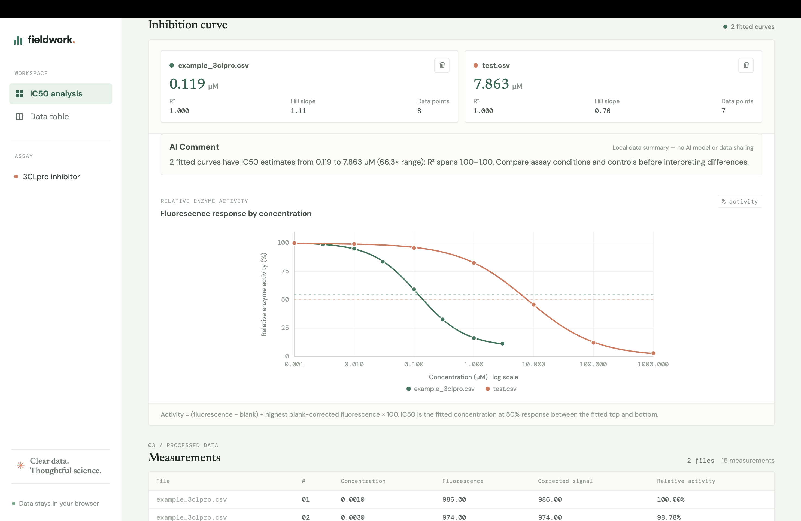

This web app is designed for biochemistry students to calculate the half-maximal inhibitory concentration (IC50) of potential inhibitors against the SARS-CoV-2 3CL protease. My idea is inspired by BCHE3730, the laboratory course that I am taking now. In drug discovery, determining the IC50 is crucial for ranking the potency of antiviral drugs. This app allows users to upload one or more datasets of raw fluorescence from a plate reader, performs background subtraction, normalizes relative enzyme activity, and uses a 4-parameter logistic (4PL) regression to fit dose-response curves.

Start screen:

Results:

